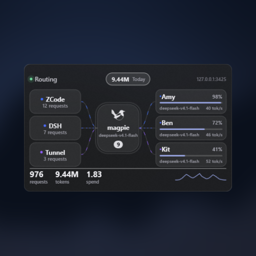

# Routes for Magpie — SnowDesktop 组件

一个 [SnowDesktop](https://snowdesktop.com/) 桌面组件：把本地 [magpie](https://github.com/yetone/magpie) 路由网关的实时路由情况放到桌面上——哪个客户端发的请求、最终由哪个账号接单、额度还剩多少、花了多少令牌。

<p align="center"></p>

> 非官方组件，与 magpie 项目无隶属关系。中文名叫「Magpie 路由板」。

## 功能

- **三列路由板**：客户端 → magpie → 账号。左侧每个客户端一个色点（品牌色），中间是 magpie 枢纽（含在线点与请求数徽章），右侧是实际接单的账号。
- **额度可视化**：每个账号显示剩余百分比与额度条，低于 15% 自动转琥珀色；悬停可看用量明细与重置天数。
- **动态数据**：账号行显示该账号最近一次请求的模型、推理强度（effort）与输出速度（tok/s）。
- **用量汇总**：底栏给出所选周期的请求数、令牌数与花费，右侧附带小时级走势。
- **周期切换**：点击顶部令牌胶囊在「今日 / 近 7 天 / 近 30 天」之间切换。
- **筛选**：点击某个客户端或账号只看它，再点一次取消；右键菜单可清除筛选。
- **紧凑模式**：把组件压到一行高度（3×1）时变成状态条：连接状态 / 近期请求数 / 周期用量。
- **外观**：默认磨砂玻璃，可切换「实色」「透明」；跟随系统深浅色。

## 安装

### 从文件安装（推荐）

1. 到本仓库的 [Releases](../../releases) 下载最新的 `magpie-routes.snowwidget`。
2. SnowDesktop → **设置 → 组件 → 从文件安装…**，选择该文件。
3. 首次添加会请求 **网络访问权限**（组件需要读取本机的 magpie 网关）。

### 作为开发组件

把仓库内容（`widget.json`、`main.lua`、`modules/`、`tests/`）放进：

```
<SnowDesktop 安装目录>\data\widgets\dev\magpie-routes\
```

然后在 **设置 → 组件 → 添加组件** 里找到「Magpie 路由」。开发目录的改动会即时生效。

## 数据来源与隐私

组件只读两台本机接口，**不写入 magpie、不联网、无遥测**：

| 接口 | 用途 |
| --- | --- |
| `/v1/magpie/usage?period=…` | 周期用量总数（与 magpie 自己的用量页同源） |
| `/v1/magpie/usage/requests?period=…&limit=24` | 近期请求行：客户端、账号、模型、耗时 |
| `/v1/magpie/quotas` | 各账号剩余额度（60 秒刷新一次） |

账号名默认完整显示，可在组件设置里勾选「隐藏账号名」。

## 设置项

| 设置 | 默认 | 说明 |
| --- | --- | --- |
| 网关地址 | `http://127.0.0.1:3425` | magpie 默认端口；改了端口时在这里改 |
| 刷新间隔 | 3 秒 | 1–60 秒 |
| 用量统计周期 | 今日 | 今日 / 近 7 天 / 近 30 天，也可点胶囊切换 |
| 隐藏账号名 | 关 | 隐藏为 `yu…` 形式 |

## 兼容性

- SnowDesktop 1.0.11.0 及以上（API v2，用到 `settings.duration`、`widget.backgroundLayer` 之外的标准能力）。
- 需要的组件能力：`task.network.request`、`draw.advanced`（画喜鹊与曲线）、`animation.frame`（请求流动）。
- 权限：`network.internet`（访问本机网关）。

## 已知限制

- **只看已完成请求**：magpie 的 `/usage/requests` 只返回已结束的请求，所以板子上是"最近请求"而不是"正在飞行"。带 in-flight 状态的只有 `/v1/magpie/trace`，但它的快照约 500 KB，超出组件沙箱的单次解析配额，因此没有采用。
- **需要本机 magpie 在运行**：组件不内置网关，连不上时显示"未连接"和网关地址。
- **账号名来自 magpie**：显示的是 magpie 记录里的账号标识（如邮箱、手机号打码形式、自动生成的 id）；长 id 会被压缩成「首段·末四位」，可在设置里选择整体隐藏。
- **中枢副标题会按宽度降级**：宽度够时显示当前主要路由的模型，不够则退到 provider，再不够显示网关地址，都放不下就不显示——不会截断成半截字。
- **最多 4 行**：单侧超过 4 个客户端或账号时，第 4 行汇总为「另有 N 个」。

## 开发

包结构：`widget.json`（清单）+ `main.lua`（入口与渲染）+ `modules/`（JSON 解析、magpie 数据投影、喜鹊矢量）+ `tests/`。

用 SnowDesktop 自带的 `snowwidget` CLI 校验（安装目录下 `widgets\snowdesktop-lua-widget\bin\snowwidget.exe`）：

```powershell
snowwidget lint    .
snowwidget test    .      # 23 个用例：JSON 解析、时间解析、数据投影、额度选取、格式化
snowwidget preview . out.png --columns 4 --rows 2 --locale zh-CN
snowwidget quality .
snowwidget pack    . magpie-routes.snowwidget
```

## 设计来源

- **视觉与布局**参考 magpie 自己的路由页（`plugins/routing`）：中性灰配色 + 单色强调、1px 发丝线、内容定高卡片、虚线流动的连线。
- **信息密度**参考 [busy-magpie](https://github.com/yimi1mi/busy-magpie)：额度币、tok/s、推理强度、紧凑状态条。

## 第三方资源

- `modules/bird.lua` 里的喜鹊轮廓来自 magpie 界面内联的 SVG 图标（`<symbol id="bird">`），
  项目地址 [yetone/magpie](https://github.com/yetone/magpie)，MIT License，Copyright (c) 2026 yetone。
  矢量被扁平化简化为 91 个点以适配 SnowDesktop 的 `draw.path` 指令上限。

## License

[MIT](LICENSE) © Yskye
